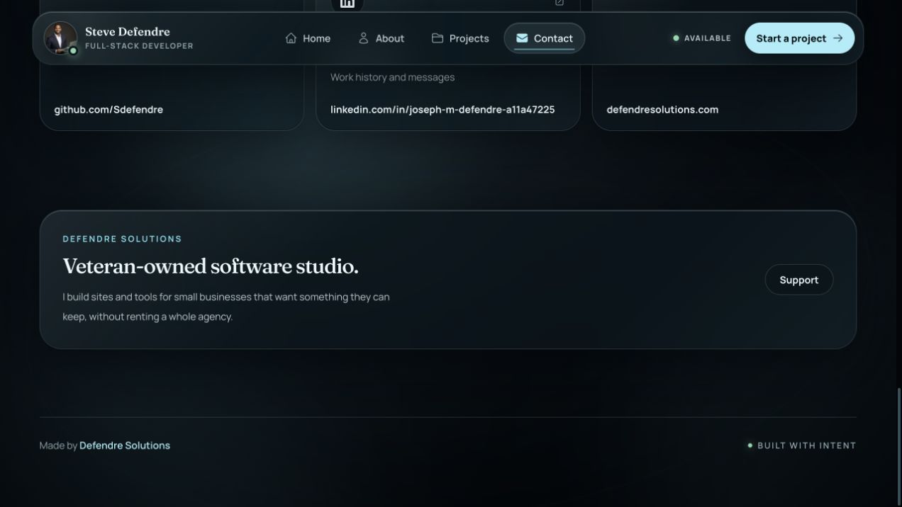

# Test and legacy-code audit — October 17, 2026

Baseline: `7524b75e5704fc1f8c69432ae33706f2d06d2d63` (freshly fetched `origin/main`). Work is isolated on `audit/portfolio-tests-20261017`; the original checkout is preserved. The initial audit was local; the subsequent shipping request authorizes the PR, CI, merge, and production verification.

Three read-only reviews covered UI/routes, data/shared contracts, and scripts/browser/CI. The root reviewed the proposed deletions and their keepers before editing. The audit prioritizes demonstrated obsolete code and duplicate coverage; an unused export is distinguished from an unused implementation.

## Candidate evidence recorded before edits

| Candidate and actual detection | Runtime callers / history | Remaining proof or migration | Deletion and risk / focused check |
| --- | --- | --- | --- |
| `SocialIcons.test.tsx`: SupportIcon `renders correctly` / `applies custom className`; checks SVG/viewBox/class forwarding for an unseen icon. `socials.test.ts`: unconditional contact icon assertion artificially requires that icon. | `SupportIcon` is referenced only by `supportLink.icon` and its direct tests. Since redesign `102f228` (#73), Support is footer-priority; contact page renders footer name/href and reads icons only for secondary links. Email's data icon is likewise never read. | Retain contact page's Support href, secure new-tab and lower-priority placement contracts, all secondary icons, and social link identity/security invariants. Restrict data icon assertion to links whose UI renders icons. | Delete SupportIcon and unused primary/footer icon fields/imports; use a discriminated readonly contact catalog. Low risk: rendered output should be unchanged. Run social/data/contact page tests, TypeScript, build and browser suite. |
| `(site)/layout_extended.test.tsx`: five URL examples; `(site)/layout.test.tsx`: four metadata URL tests. Their `../layout` actually imports the root layout. | Root layout exports shared `siteMetadata`; these old tests predate the shared resolver matrix added by `d1bbdaa` (#123). No runtime dependency on test scaffolding. | `site-url.test.ts` exercises resolver, shared metadata, page canonical, robots and sitemap across precedence, malformed inputs, schemes, paths and ports. Preserve multiple-subdomain input in its existing hostname/port row. `site-metadata.test.ts` protects exact social image descriptors and JPEG bytes; browser metadata tests protect root layout wiring. | Delete extended file and redundant env/module/mock/image scaffolding. Retain site layout Analytics and dock clearance tests. Low risk: test-only consolidation. Run URL/metadata/root/site layout tests. |
| `projects.test.ts`: `lists the public fields agents can read` duplicates list/filter tool public projection and filter URL checks. | Both helper and tool suites introduced in `8adf264` (#102). Runtime `listPublicProjects` callers in `webmcp.ts` always pass the full or filtered catalog. `toPublicProjectSummary` is used only inside the data module. | Keep `webmcp.test.ts` list/filter results, including all public fields, Product titles, href and actual navigation; keep catalog URL/asset invariants and ProjectExplorer behavior. | Remove duplicate helper test, no-argument default and unused projection export. Low risk; run data, WebMCP and explorer tests. |
| `ContactComposer.test.tsx`: encoded-draft assertion directly calls exported builder after a separate form submit; fallback test directly calls two helpers. | Builder, Unicode repair function and values type are used internally only; their exports exist for tests. Unicode fallback was deliberately retained by `6a3e641` (#122) for older browsers. | Move exact draft assertion to the anchor actually clicked by form submit. Exercise missing-native Unicode fallback via populated form, validation and actual clicked URL, preserving valid emoji pairs and replacing lone halves. Keep native-path, overflow, timing and handoff-failure tests. | Make helpers/type private; do not delete fallback runtime code. This strengthens proof that the form uses the correct payload. Run composer test and contact/accessibility browser tests; mutation-check encoding fallback. |
| `webmcp.test.ts`: `unregisters tools when the registration signal aborts` uses a mock abort listener to delete its own map. Also repeats navigate schema enum already checked in full. | Registration implementation delegates lifetime to the browser's signal API (`8adf264`, #102). Existing test indirectly detects missing signal forwarding, but its name overstates browser-unregistration proof. | Assert each real registration call receives the caller's exact signal; keep registrar unmount-abort test. Preserve schema/protocol, execution and input safety assertions. | Remove fake browser lifecycle implementation and duplicate schema assertion; no runtime cancellation removal. Low risk; run WebMCP and registrar tests; mutation-check signal forwarding. |
| `Sidebar.test.tsx`: `renders all navigation items` repeats four text checks already protected by role-based route assertions in `uses a compact tablet header while preserving every critical route`. | Both render the same current Sidebar. The compact-header regression added by `c3be6e9` (#112) includes all four accessible links plus CTA/layout contracts. | Retain stronger header test, active-page, social, profile and CTA tests and actual browser navigation/viewport tests. | Remove one duplicate invocation only. Low risk; run Sidebar and navigation browser tests. |
| `e2e/contact.spec.ts`: `renders complete route-specific and shared social metadata` overlaps contact row in `metadata.spec.ts`. | Introduced by `3adcdaf` to protect rendered contact social metadata; the cross-route browser owner later added by `db60578` also protects uniqueness, image dimensions/alt and Twitter description. | Move canonical, OG URL/type/locale/site_name into the existing contact metadata row before retiring duplicate invocation; leave other routes' distinct 404 canonical behavior unchanged. | Delete duplicate browser test, retain all assertions at same real-browser boundary. Low risk; run full browser suite and deliberately mutate rendered contact metadata. |

## Retained candidates

- Every component module has a production route/layout caller. Keep navigation render functions, document-navigation behavior, project fallback and safe-link branches. Current catalog population alone cannot establish that optional rendering is obsolete.
- Keep URL normalization security regressions (`2b925b6`), CSP/redirect tests, canonical environment matrix and actual-image-byte checks.
- Keep static-home freshness, transitive-renderer, failed-publication and preload guards; they cover behavior that route unit tests cannot reach.
- Keep verification helper lifecycle, signal identity and atomic-state tests; they exercise real processes and platform safety.
- Keep reduced-motion/transparency and responsive CSS guards where they are independent regression contracts, even when source inspection is the cheapest proof.
- Keep `public/project-previews/apple-app-intents.jpg`: no current catalog reference, but historical evidence references it and its published URL may have external consumers. Lack of a local caller is insufficient removal proof.
- Do not strip every unused type/export or optional prop merely to increase counts. The selected production changes retire demonstrated unused runtime data/code or test-only seams.

## Validation

Baseline Vitest: 33 files / 188 tests pass. Static-home: 12 pass. Verification helpers: 26 pass, 2 Linux-only tests skipped on macOS. Baseline production build passes. All 41 baseline browser tests pass across Chromium, Firefox and WebKit.

The first replacement fallback unit test exposed a harness constraint: jsdom 28's `webidl-conversions` USVString implementation itself calls `String.prototype.toWellFormed` when setting `anchor.href`. Removing that native method causes a jsdom TypeError even for a plain ASCII mailto. A direct minimal reproduction confirmed the stack, so no product workaround was added. The fallback regression moves to the real-browser accessibility lane (all three engines), which can simulate the absent method without breaking its native DOM. The test constructs the lone UTF-16 half in the browser to avoid automation transport normalization.

## Final changes and preservation proof

- Removed the retired Support SVG and unused Email/Support data icon fields; the actual Support link remains. Made contact encoding helpers and their values interface private, removed the project helper's test-only default, and kept its projection helper private.
- Retired 13 obsolete/duplicate unit cases. Moved one additional fallback unit case into the three-engine browser accessibility lane. Consolidated one contact browser metadata test into its existing owner, preserving all five distinct assertions. Unit totals change from 33 files / 188 tests to 32 files / 174 tests; browser totals change from 41 to 43 (three fallback cases replace one duplicate metadata invocation).
- The root and three independent reviewers compared removed assertions against keepers. The only requested preservation improvement was verifying that the real-browser fixture contains a lone `0xD83D` code unit; this is now asserted before React receives the event. The tooling reviewer re-read the final test and marked the concern resolved.
- Four deliberate production mutations were caught, then restored byte for byte: omit WebMCP registration signal; send the wrong mailto URL; bypass fallback surrogate repair; change the Open Graph site name. The first two failed their focused unit keeper assertions. Broken surrogate repair failed all three browser engines; trace pageError events confirm `URIError` during application encoding, and no successful draft handoff. Changed site name failed the migrated contact metadata assertion with the wrong received content. These were temporary proof controls, not product changes or unresolved failures.
- Production changes: 8 added / 18 removed lines (net -10). Tests: 70 added / 394 removed lines (net -324). Test support/tooling: no separate production helper or script added. Generated manifest: two input-hash lines changed; homepage HTML, CSS and fonts retain exactly the baseline output paths and hashes. Documentation is excluded from these counts.
- No genuine product defect was established by this audit. Baseline tests were green; no failing contract was deleted to hide a bug. The failed first fallback replacement was the independently reproduced jsdom compatibility constraint documented above.

## Checks and limitations

- `npm test`: 174/174 pass across 32 files after all source/test edits and restored mutations.
- `npm run lint`: passes with zero errors. One existing `@next/next/no-head-element` warning remains in the standalone static HTML renderer (`scripts/render-static-home.tsx`); its complete-document `<head>` is intentional, and this file was not changed.
- `npx tsc --noEmit`, `npm run build`, `npm run test:static-home` (12/12), `npm run check:static-home`, and `git diff --check`: pass.
- Verification helpers ran on the baseline: 26 pass, two Linux procfs-only cases skipped on this Mac. Helpers and their tests were unchanged, so they were not redundantly rerun.
- `CI=1 npm run test:e2e -- --reporter=line,json`: 43/43 pass across Chromium, Firefox and WebKit, zero retries/flakes/failures; includes real production routes and responsive viewport checks.
- Audit-stage local runtime was Homebrew Node 26.11.1 / npm 11.20.0. At audit completion, GitHub CI's Node 22 and Linux helper lane had not run; the release PR tracks those checks. Historical browser engines are simulated by absence of the relevant API; this is not a claim of testing old browser binaries.
- At initial audit completion, changes were uncommitted and no publication had occurred. The subsequent release is tracked in the PR and final chat handoff. The primary checkout remains at its original revision.

Evidence: [validation summary](evidence/test-audit-2026-10-17/validation.json). The historical asset remains intentionally retained. Remote Linux/Node 22 checks and exact-revision production proof are release gates tracked by the PR and final handoff.

## Before/after release screenshots

The before image is `/contact` on production deployment `dpl_9gDFq9YTj3B9uGvkDHVLs4LU4ie5`, verified at baseline SHA `7524b75e5704fc1f8c69432ae33706f2d06d2d63`. The after image is the audit branch's production build at `http://127.0.0.1:3117/contact`. Both were captured in the same browser viewport at the Support/footer area. The Support link remains visibly unchanged because the retired icon was never rendered here.

| Before | After |
| --- | --- |
|  |  |
